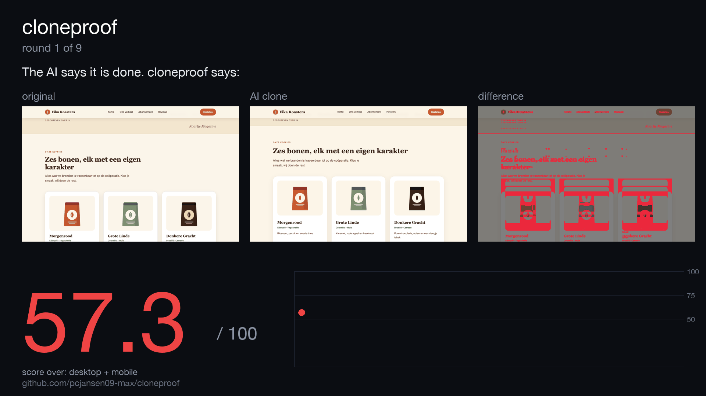

# cloneproof

[](https://github.com/pcjansen09-max/cloneproof/actions/workflows/tests.yml)  

**Don't ask your AI to clone a website. Make it prove it.**

AI "website cloners" take a screenshot, build something that looks roughly right, and tell you it
is done. Then you spend hours on "the font is wrong, the hero doesn't animate, mobile is broken".

`cloneproof` is the missing half: a **measuring tool** that compares your clone to the original in
a real browser, gives a score from 0 to 100, tells you *exactly* what is different (down to
`font-size: original 64px, clone 56px on section.hero > h1`), and writes the **prompt** that sends
your AI agent back to fix it. Run it in a loop and the agent keeps going until the clone is 1:1.

```
$ cloneproof compare https://original.example ./my-clone

score 61.4 / 100  (recognisable, clearly different)
  desktop   66.0   visual 52  layout 71  style 83  content 92  assets 100  motion 40
  tablet    63.2   ...
  mobile    54.1   visual 38  layout 60  ...

biggest differences:
  [desktop] <h1> "We build calm software" font-size: original 64px, clone 56px
  [mobile]  `nav a` is 79px too far right
  [desktop] font not loaded in clone: Inter 600
  [desktop] scroll step 3->4: the clone is more static than the original

report   : .cloneproof/latest/report.html
prompt   : .cloneproof/latest/prompt.md   (give it to your agent)
```



*A real run. An AI (Claude Sonnet) rebuilt a page from screenshots and said it was done: **57.3 / 100**.
cloneproof measured it, handed the exact differences back, and the loop took it to **96.6** in nine rounds
(desktop + mobile; one round got worse and was rolled back automatically). The page, the screenshots and the final clone are in
[`examples/fika`](examples/fika); the video is [`docs/demo.mp4`](docs/demo.mp4).*

## Why this exists

Everyone who tried an AI website cloner knows the loop: it looks right at first glance, and then you
find out it is not. The tools are good at *making* a clone and blind to *checking* it, so the checking
is you, squinting at two browser tabs. cloneproof takes over the squinting:

- **It measures, it doesn't guess.** Pixels (with the original's own noise removed), element boxes,
  computed styles, text, fonts, and whether the page moves while scrolling like the original does.
- **It works on three screen sizes.** Desktop, tablet, mobile. The "75% accurate" clone usually dies on mobile.
- **It tells the agent what to do.** Not "it looks off", but the selector, the property and the value.
- **It closes the loop.** `cloneproof loop` runs measure, fix, measure until the target score.
- **It is local.** No API keys, no accounts, no server. Playwright and Python.

## Install

```bash
pip install git+https://github.com/pcjansen09-max/cloneproof      # or: pipx install git+https://github.com/pcjansen09-max/cloneproof
cloneproof doctor             # checks the browser; if missing: python -m playwright install chromium
```

## Use

```bash
# 1. measure (original and clone can be URLs or folders of static files)
cloneproof compare https://original.example http://localhost:3000
cloneproof compare https://original.example ./dist --open       # opens the HTML report

# 2. fast mode while iterating: desktop only, no noise calibration (all three viewports run in parallel by default; --serial for weak machines)
cloneproof compare https://original.example http://localhost:3000 --quick

# 3. machine readable (exit code 0 = target reached)
cloneproof compare https://original.example http://localhost:3000 --json --target 97

# 4. let an agent fix it, automatically
cloneproof loop https://original.example http://localhost:3000 \
    --agent "claude -p --permission-mode acceptEdits" --target 97 --rounds 6
```

The agent is any command that reads a prompt on stdin: `claude -p`, `codex exec -`, a script.

### Teach your agent to use it

```bash
cloneproof init-agent        # writes a skill for Claude Code / Codex / Cursor (.claude/skills, .agents/skills) + AGENTS.md
pip install "cloneproof[mcp] @ git+https://github.com/pcjansen09-max/cloneproof" && claude mcp add cloneproof -- cloneproof mcp    # or as an MCP tool
```

After that, "make this site match https://example.com" makes the agent measure instead of eyeball.

### Need a local reference or a starting point?

```bash
cloneproof capture https://your-own-site.example --out mirror   # offline mirror, incl. lazy images, video, fonts, 3D files
cloneproof serve mirror
```

### In CI and in your README

```yaml
# .github/workflows/clone.yml: fail the build when a migration drifts from the original
- uses: pcjansen09-max/cloneproof@main
  with:
    reference: https://old-site.example
    clone: https://staging.new-site.example
    target: 95
```

```bash
cloneproof compare https://original.example ./dist --badge cloneproof-badge.svg   # then: 
```

## What you get

Every run writes `.cloneproof/latest/`:

| file | what |
|---|---|
| `report.html` | slider + difference view for every scroll position, issues list, the prompt |
| `prompt.md` | the fix prompt for your agent |
| `report.json` | everything, for scripts |
| `scorecard.png` | 1200x630 image of the result, ready to post |
| `<viewport>/NN-{original,clone,diff}.png` | the frames |

## What the loop can and cannot do

In our runs the loop lifts an AI clone by 20+ points (58 to 82 on all three widths in eight rounds, 57 to 96.6 on desktop + mobile
with more rounds). Past the low 80s it needs many rounds or a stronger agent; it is not magic. Full table in
[docs/benchmarks.md](docs/benchmarks.md).

## Tested on real sites

Thirteen real sites, mirrored and measured against the live originals: median **93.7**, six above 96
(Hacker News, example.com, three.js, Linear, delta-design.nl, WordPress.org). The weak ones are listed with the
reason in [docs/benchmarks.md](docs/benchmarks.md), including the eight bugs this stress test found in cloneproof itself.

## Against the usual tools

The same seven pages saved by cloneproof, SingleFile, HTTrack and wget, then judged by cloneproof: mean 97.9, 91.8, 46.5 and 89.1
(median of the pages that finished: 99.8, 97.7, 55.4, 97.7). The judge is also a contestant, so read the caveats and rerun it
yourself: [docs/showdown.md](docs/showdown.md).

## Hard sites

Modern sites build their own URLs, check their own files and sometimes refuse a headless browser. [docs/hard-sites.md](docs/hard-sites.md) lists
what breaks (bot walls, Next.js streaming data, import maps, `new URL()`, integrity hashes, ...), what cloneproof does about it, and a stress test
on 34 hard sites (median 75.8 on a quick desktop run; 15 of 33 score 80 or more; the failures are named). For a bot wall a human has to pass,
attach your own Chrome: `cloneproof capture URL --cdp http://127.0.0.1:9222`.

## How the score works

See [docs/how-it-works.md](docs/how-it-works.md). In short: visual 50, layout 20, style 12,
content 8, assets 5, motion 5. Desktop 45%, mobile 35%, tablet 20%. The original is probed twice so that
carousels and clocks don't count against you, and a vertical shift is blamed once, where it starts,
instead of on everything below it.

## Responsible use

cloneproof compares two pages and can mirror one. Use it on sites you own, sites you build for a
client, migrations, or layouts you are studying. Do not publish someone else's copyrighted content,
trademarks or brand, and do not build lookalikes of login or payment pages. The mirror command prints a
reminder; the responsibility is yours.

## Limits

WebGL/canvas is compared as pixels only. Hover and focus are checked on up to 16 visible links/buttons
above the fold (informational, not scored, see [docs/how-it-works.md](docs/how-it-works.md)); click states
and form validation are not compared yet. Pages behind a login need `--header "Cookie: ..."`. Some bot walls
block headless browsers; try `--headed` or `--chrome`.

## Roadmap

- [x] website vs website
- [x] hover / focus states (desktop & mobile, informational)
- [ ] click states and form validation
- [ ] side-by-side scroll video export
- [ ] mobile apps and desktop software (screenshots + accessibility tree)
- [ ] built-in clone builder

## License

MIT
